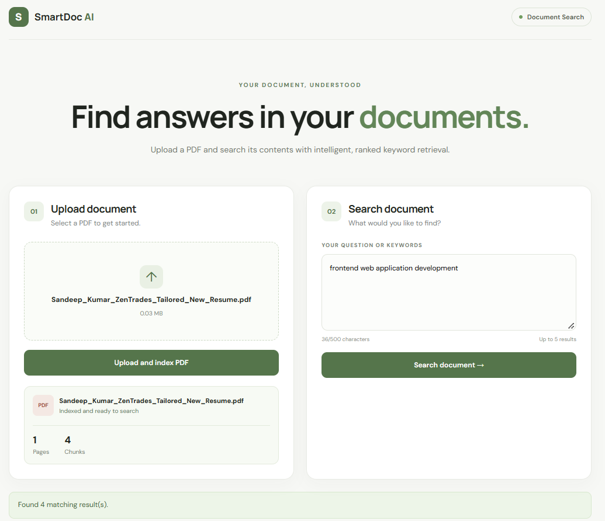

# SmartDoc AI — Hybrid RAG with Reranking

A full-stack AI-powered PDF search application that combines keyword retrieval, semantic search, Reciprocal Rank Fusion (RRF), and cross-encoder reranking to retrieve relevant information from documents.

## Overview

SmartDoc AI allows users to upload PDF documents and search their contents using natural-language queries. Instead of relying on keyword matching alone, it combines lexical and semantic retrieval to improve the relevance of search results.

The backend extracts text from PDFs, splits it into manageable chunks, retrieves candidate chunks through BM25 and semantic similarity, combines the rankings using Reciprocal Rank Fusion, and reranks the candidates with a cross-encoder.

The frontend provides a simple interface for uploading PDFs and viewing ranked results with page numbers and relevance scores.

## Features

- **PDF Upload:** Upload PDF documents through a web interface.
- **Text Extraction:** Extract text while preserving page numbers.
- **Text Chunking:** Split extracted text into overlapping chunks.
- **Keyword Search:** Retrieve relevant passages using BM25.
- **Semantic Search:** Find passages using sentence embeddings and cosine similarity.
- **Hybrid Retrieval:** Combine keyword and semantic rankings using Reciprocal Rank Fusion.
- **Cross-Encoder Reranking:** Rerank candidate passages based on query-document relevance.
- **REST API:** Expose document upload and search functionality through FastAPI.
- **Interactive Frontend:** Search documents through a React and TypeScript interface.
- **Automated Testing:** Validate retrieval, API behavior, reranking, and edge cases.
- **Retrieval Evaluation:** Measure search quality using Recall@K and Mean Reciprocal Rank (MRR).

## Application Preview

SmartDoc AI provides a web interface for uploading PDFs and searching their contents.



## Architecture

The application follows this retrieval pipeline:

1. User uploads a PDF.
2. FastAPI validates the file.
3. PyMuPDF extracts text and page numbers.
4. The chunker creates overlapping text chunks.
5. BM25 performs keyword retrieval.
6. Sentence Transformers generates embeddings for semantic retrieval.
7. Reciprocal Rank Fusion combines the retrieval rankings.
8. A cross-encoder reranks the candidate chunks.
9. The API returns ranked results to the frontend.

For the architecture diagram, see [docs/architecture.md](docs/architecture.md).

## Tech Stack

| Component | Technology |
|---|---|
| Frontend | React, TypeScript, Vite |
| Backend | Python, FastAPI |
| PDF Processing | PyMuPDF |
| Keyword Retrieval | BM25, rank-bm25 |
| Semantic Retrieval | Sentence Transformers |
| Embeddings Model | all-MiniLM-L6-v2 |
| Reranking Model | ms-marco-MiniLM-L-6-v2 |
| Ranking Fusion | Reciprocal Rank Fusion (RRF) |
| Numerical Computing | NumPy |
| Testing | pytest, HTTPX |
| Version Control | Git and GitHub |

## Project Structure

```text
SmartDoc-AI/
├── backend/
│   ├── __init__.py
│   ├── main.py
│   ├── pdf_processor.py
│   ├── chunker.py
│   ├── keyword_search.py
│   ├── semantic_search.py
│   ├── hybrid_search.py
│   ├── reranker.py
│   └── evaluate_retrieval.py
├── frontend/
│   ├── src/
│   │   ├── App.tsx
│   │   ├── App.css
│   │   └── index.css
│   ├── package.json
│   └── ...
├── docs/
│   ├── architecture.md
│   └── screenshots/
│       └── smartdoc-search.png
├── sample_data/
├── tests/
│   ├── test_api.py
│   ├── test_keyword_search.py
│   ├── test_semantic_search.py
│   ├── test_hybrid_search.py
│   ├── test_reranker.py
│   └── evaluation_dataset.json
├── .gitignore
└── README.md
```

## Getting Started

### Prerequisites

Install the following before running the application:

- Python 3.12
- Node.js and npm
- Git

Python 3.12 is recommended for this project.

### 1. Clone the Repository

```bash
git clone https://github.com/Sandeepkumar004-hub/SmartDoc-AI.git
cd SmartDoc-AI
```

### 2. Create and Activate a Python Virtual Environment

On Windows:

```powershell
py -3.12 -m venv .venv
.\.venv\Scripts\Activate.ps1
```

If PowerShell blocks activation, use the Command Prompt activation script instead:

```bat
.venv\Scripts\activate.bat
```

### 3. Install Backend Dependencies

With the virtual environment activated, run:

```bash
python -m pip install --upgrade pip
pip install fastapi "uvicorn[standard]" python-multipart pymupdf rank-bm25 sentence-transformers numpy pytest httpx
```

The semantic embedding and cross-encoder models may download automatically the first time they are loaded. An internet connection may be required for the initial download.

### 4. Start the Backend

From the project root, run:

```bash
python -m uvicorn backend.main:app --reload
```

The backend will be available at:

- API: http://127.0.0.1:8000
- Interactive API documentation: http://127.0.0.1:8000/docs
- Health check: http://127.0.0.1:8000/health

Keep this terminal running.

### 5. Start the Frontend

Open a second terminal and run:

```powershell
cd frontend
npm install
npm run dev
```

Open the local URL shown by Vite, usually:

http://localhost:5173

You can now upload a PDF and search its contents.

## API Endpoints

### Health Check

`GET /health`

Returns the backend health status.

Example response:

```json
{
  "status": "healthy"
}
```

### Upload a PDF

`POST /upload`

Uploads a PDF, extracts its text, creates chunks, and builds the hybrid search index.

The current implementation accepts PDF files up to 10 MB.

Example response:

```json
{
  "filename": "example.pdf",
  "page_count": 5,
  "chunk_count": 12,
  "message": "PDF processed and hybrid index built successfully.",
  "retrieval_method": "hybrid_bm25_semantic_rrf"
}
```

### Search Documents

`POST /search`

Searches the currently indexed PDF using a natural-language query.

Example request:

```json
{
  "query": "What technologies are used for web development?",
  "top_k": 5
}
```

Example response structure:

```json
{
  "query": "What technologies are used for web development?",
  "filename": "example.pdf",
  "retrieval_method": "hybrid_bm25_semantic_rrf",
  "result_count": 1,
  "results": [
    {
      "chunk_id": 1,
      "page_number": 1,
      "text": "Example text extracted from the PDF.",
      "score": 0.85,
      "rrf_score": 0.032
    }
  ]
}
```

The response above is illustrative. Actual results and scores depend on the uploaded document and model predictions. The `score` field represents the cross-encoder reranking score in the current implementation; it is not a calibrated probability and can be negative.

## Retrieval Evaluation

SmartDoc AI includes a retrieval evaluation script that measures search quality using Recall@K and Mean Reciprocal Rank (MRR).

### Current Results

The current evaluation was run on a small synthetic dataset containing five queries and three sample document chunks.

| Metric | Result |
|---|---:|
| Mean Recall@3 | 1.000 |
| Mean Reciprocal Rank (MRR) | 1.000 |
| Automated tests | 34 passed |

### Run the Evaluation

From the project root, with the virtual environment activated:

```bash
python -m backend.evaluate_retrieval
```

### Run Automated Tests

```bash
python -m pytest -q
```

The current test suite has passed all 34 tests.

### Interpreting the Results

Recall@3 measures the fraction of known relevant chunks retrieved among the top three results. MRR measures how highly the first relevant result is ranked across queries.

These results demonstrate that the current implementation works well on the small, controlled evaluation dataset. They should not be interpreted as proof of production-level performance. A larger, independently reviewed dataset with varied queries and documents is needed for a more representative assessment.

## Current Limitations

- Only one PDF is indexed at a time.
- The search index is stored in memory and is lost when the backend restarts.
- Scanned PDFs without extractable text are not supported because OCR has not been implemented.
- The embedding and reranking models may need to be downloaded on first use.
- The evaluation dataset is small and synthetic.
- The current application does not generate natural-language answers from retrieved passages; it returns ranked document chunks.

## Future Improvements

- Support multiple documents and persistent indexes.
- Add OCR for scanned PDFs.
- Add larger and more diverse retrieval benchmarks.
- Compare BM25, semantic search, hybrid retrieval, and reranking independently.
- Add retrieval filters and document management.
- Add source highlighting and improved result previews.
- Introduce answer generation with citations using a Retrieval-Augmented Generation (RAG) pipeline.
- Deploy the frontend and backend for public access.
- Add continuous integration to run automated tests on each change.

## Security and Privacy

- Uploaded PDF files are processed by the backend and temporary upload files are removed after processing.
- Do not commit private documents, resumes, credentials, API tokens, or other sensitive information to the repository.
- The current implementation is a portfolio prototype and should be hardened before handling sensitive documents in production.

## Author

**Sandeep Kumar**

- GitHub: [Sandeepkumar004-hub](https://github.com/Sandeepkumar004-hub)
- Project Repository: [SmartDoc-AI](https://github.com/Sandeepkumar004-hub/SmartDoc-AI)

---

If you find this project useful, consider starring the repository.
