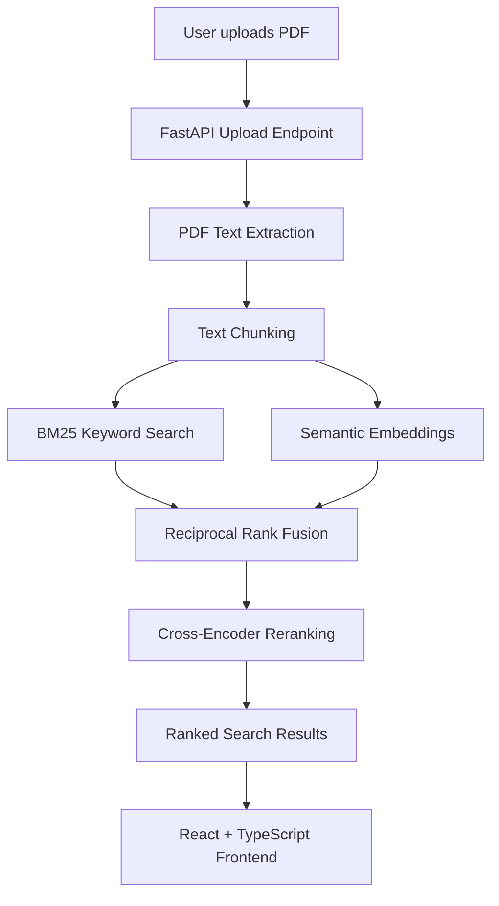

# SmartDoc AI Architecture

## Document Retrieval Pipeline

## Components

- **Frontend:** React and TypeScript interface for PDF uploads and search.
- **API:** FastAPI handles document uploads and search requests.
- **PDF processing:** PyMuPDF extracts text, and the chunker splits it into smaller passages.
- **Keyword retrieval:** BM25 ranks passages using matching terms.
- **Semantic retrieval:** Sentence Transformers generates embeddings for meaning-based search.
- **Hybrid retrieval:** Reciprocal Rank Fusion combines the two rankings.
- **Reranking:** A cross-encoder reorders candidate passages according to query relevance.
- **Results:** The API returns ranked text passages with page numbers and relevance scores.

## Current Scope

The application currently indexes one active PDF at a time and stores its index in memory. Restarting the backend clears the index.
